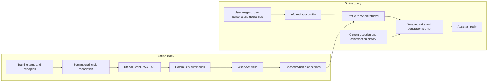

# GraphRAG-Persona

A user-persona personalization pipeline built on **official GraphRAG 0.5.0**. Offline indexing turns principle-linked dialogue examples into community summaries and reusable When/Act skills. At query time, the system infers a user profile, retrieves relevant skills, and uses them to guide an assistant reply.

**This repository provides a small, sampled example pipeline. It does not include the complete training/test datasets or a full benchmark reproduction.** Generation and embedding are accessed through configurable OpenAI-compatible services; Qwen3.5-4B and BGE-M3 are reference choices that can be replaced with compatible models. Other datasets can be used after conversion to the supported input schemas.

Only the **user's persona** is modeled. Attributes and experiences stated by the assistant are not assigned to the user. Principles, prompts, generated community reports, and generated skills in the example are in English.



## Included example data and artifacts

| Item | Included scope |
| --- | --- |
| English principles | All 43 principles in `principles.json` |
| Synthetic-Persona-Chat training subset | 1,199 assistant-turn examples, sampled uniformly without replacement from 119,926 examples using seed 42 |
| Bundled offline index | Only the first **3** subset examples were processed; 2 were associated with principles |
| Synthetic-Persona-Chat query example | One user-side test example: `test-00001-02` |
| ElderlyTech-VQA query example | Only `elderlytech_vqa_139`: image, question, reference profile, and reference responses |
| Graph artifacts | 22 entities, 21 relations, 5 assigned communities, and 6 native community reports |
| Skills | 5 English When/Act skills in `skill/graphrag/` |
| Saved online example | Sample 139's English inferred profile, reply, full trace, and verification |

One native report has `community=-1`; it is preserved as an official output but is not compiled into a skill. The training sampling manifest records the original source count/hash, although the full source file is omitted.

The bundled graph, embedding matrix, profile, and reply are **historical results produced before the API client migration**. They are not measurements of the current API implementation. Project paths in example metadata were made repository-relative; native Parquet contents and reply text were preserved. The saved skill digest was refreshed for that metadata relocation.

The historical five-row embedding cache keeps its original signature. The current adapter detects it as stale and rebuilds it through the configured embedding service. The copy excludes indexing caches, the sampling script, plotting code, original Chinese rule skills, full datasets, and full-run/baseline results.

## Environment and dependencies

Use **Python 3.11** and keep `graphrag==0.5.0`. GraphRAG 0.5.0 declares Python support for `>=3.10,<3.13`.

```bash
python -m pip install -r requirements.txt
python -m pip check
```

`requirements.txt` covers official indexing, API-based text queries, metrics, and protocol tests. `requirement.txt` is a compatibility alias containing `-r requirements.txt`.

For **local image-profile inference**, first install a matching PyTorch/Torchvision build for your OS, GPU, and driver using the [official PyTorch installation selector](https://pytorch.org/get-started/locally/). Use PyTorch 2.5 or later, then install the additional vision libraries:

```bash
python -m pip install -r requirements-vision.txt
python -m pip check
```

The image path uses `Qwen3VLForConditionalGeneration` and the PIL image processor provided by the pinned Transformers version. Configure local weights through `MODEL_PATH` in `scripts/infer_user_profile.py`; the default is `D:/Models/Qwen3-VL-2B-Instruct`. The text-only query path does not load this vision model. Model weights and model-serving software are not bundled.

Dependency declarations were audited against installed package metadata and the existing environment; **a clean installation has not been validated**. They are direct-dependency pins, not a complete environment lock. The optional vision group declares a Click version compatible with its pinned Hugging Face Hub version; the reference machine's existing Hub/Click combination did not satisfy that requirement. GPU-specific wheels must be chosen separately rather than inferred from this machine's cross-environment setup.

## Configure model services

Replace the endpoint placeholders before any API inference. URLs must include the API prefix, such as `https://your-server.example/v1`. Generation and embedding may use the same server or different servers.

| Configuration | Purpose |
| --- | --- |
| `index/settings.yaml` → `llm` | Principle association, official GraphRAG extraction/reporting, and community-to-skill compilation |
| `query_settings.yaml` → `llm` | Online text-profile inference and final reply generation |
| `query_settings.yaml` → `embeddings` | Offline When vectors and online profile-query vectors |
| `query_settings.yaml` → `k`, `epsilon` | Skill count and strict similarity cutoff |

Example structure for `query_settings.yaml`:

```yaml
k: 1
epsilon: 60
llm:
  api_base: <GENERATION_API_BASE>
  api_key: local
  model: <GENERATION_MODEL_ID>
  request_timeout: 600
embeddings:
  api_base: <EMBEDDING_API_BASE>
  api_key: local
  model: <EMBEDDING_MODEL_ID>
  request_timeout: 600
```

`model` is the ID advertised by the service; even a path-shaped ID is not a request to load weights in the query process. Set credentials as required by your service. The disabled `embeddings` block in `index/settings.yaml` is not the active When-embedding configuration: official text embedding generation is skipped, and `index.py` uses `query_settings.yaml` for the skill matrix.

Generation requires streaming `/chat/completions` with `temperature=0` and `max_tokens`. The current client also sends `chat_template_kwargs.enable_thinking=false`; adapt that extension in `scripts/generate_answer.py` if a replacement server does not support it. Embedding requires `/embeddings` with float vectors and input indices. Vectors are L2-normalized locally, and their dimension is inferred from the response rather than fixed to BGE-M3's dimension. There is no local ONNX embedding backend.

## Offline indexing

Entry point: `index.py`.

1. Read user-side assistant-turn training examples and the 43 English principles. Each example contains the user persona, conversation history ending with the current user message, and the target assistant response.
2. Ask the generation model which principles are semantically relevant. Examples with no related principles are skipped. This is an LLM judgment, not an embedding threshold.
3. Pass the associated documents to the **unmodified official GraphRAG 0.5.0 workflows**, which perform entity/relation extraction, merging, description summarization, Leiden community detection, and community report generation.
4. Compile one When/Act skill for each assigned report at the selected community level, defaulting to level 0. `When` defines applicable user characteristics and essential situations; `Act` guides the assistant's tone, content, or response sequence.
5. Embed each skill's **When section only** through the embedding service and save the matrix for reuse.

```bash
# Inspect the configured native workflows and input count without API inference.
python index.py --limit 3 --dry-run

# Rebuild the three-example demonstration index and skills.
python index.py --limit 3

# Use another prepared training file.
python index.py --train path/to/train.jsonl --limit 100
```

The default training file is `data/synthetic_persona_chat_user_side/train_sample_1pct.jsonl`. Running without `--limit` processes all **1,199 included examples**, not the original 119,926. Sampling is a separate preprocessing step and is not run automatically; its script is intentionally omitted from this copy. Indexing builds retrieval knowledge and does not fine-tune model parameters.

Native tables and bookkeeping are written directly to `index/output/`, including `create_final_entities.parquet`, `create_final_relationships.parquet`, `create_final_communities.parquet`, and `create_final_community_reports.parquet`. Skills are written to `skill/graphrag/`, and the When matrix to `data/graphrag_skill_when_embeddings.npz`.

Use `--resume` only for the same inputs and settings: native workflow resumption can reuse existing Parquet files even after a prompt change. Rebuild affected outputs when changing principles, data, or prompts. Embedding cache signatures include the endpoint, model ID, skill names, and When text; Act-only edits do not require re-embedding.

## Online query

Entry point: `main.py`; orchestration functions are in `scripts/pipeline.py`.

The process initializes the API clients, prepares or loads the offline skill matrix, and loads the local vision model when needed. It then loops over the selected query examples:

1. **Infer the user profile.** Image examples use Qwen3-VL-2B locally. Text examples use the configured generation service to infer a profile from the user persona and the user's own historical utterances. Explicit fields cover age group, gender presentation, and role; implicit fields cover personality, values, and communication preferences. Reasonable uncertain estimates are retained, and unknown fields may be `null`.
2. **Retrieve skills.** Serialize populated profile fields into an English query, request its embedding, and rank cached When vectors by `score = 100 * cosine_similarity`. Retain up to `k` skills satisfying **`score > epsilon`**; the default is `k=1`, `epsilon=60`. The retrieval query contains profile fields rather than the current question.
3. **Generate a reply.** Insert the profile, selected When/Act skills, current question, and available conversation history into `prompt/final_generation.txt`. The generation model checks skill applicability to the question and produces the current assistant reply. Dataset reference answers are retained for scoring and do not enter this generation prompt.

Run commands from the repository root after configuring the services:

```bash
# The retained image example is sample ID 139, but its reduced manifest offset is 0.
python main.py --limit 1 --output output/new-image-demo

# Run the one retained text example without loading a vision model.
python main.py --dataset synthetic-persona-chat --limit 1 --output output/new-text-demo

# Point the text adapter at another compatible query file.
python main.py --dataset synthetic-persona-chat --data path/to/test.jsonl --limit 10 --output output/custom
```

`--settings` selects another query YAML, `--offset`/`--limit` select examples, and `--resume` skips results only when the saved sample and run settings match. By default, full traces are printed and saved as `<sample_id>_pipeline.json`, with replies in `<sample_id>_answer.txt`. `--compact` reduces console output while retaining complete saved traces. `main.py` re-infers profiles; it does not automatically reuse the example in `input/`.

## Evaluation

### Response quality

References are `answer_gpt4o` for ElderlyTech-VQA and `target_response` for the user-side Synthetic-Persona-Chat format. The shared evaluator in `scripts/evaluate_user_vlm.py` reports:

| Metric | Implemented definition |
| --- | --- |
| BLEU-2 | Mean sentence BLEU with unigram/bigram weights `(0.5, 0.5)`, NLTK method-3 smoothing, and case-sensitive whitespace tokenization |
| ROUGE-L F1 | Mean longest-common-subsequence F1 using lowercase ASCII alphanumeric tokens and Porter stemming for tokens longer than three characters |
| Distinct-2 | Number of distinct bigrams divided by total bigrams over all predictions; bigrams are formed within each answer, never across answer boundaries |

Scores are fractions on `[0, 1]`. Empty answers and token-limit terminations are also reported. The current tokenizer choices are oriented toward English and should be adapted for other languages.

The following Python snippet runs from the repository root and scores the **bundled historical sample 139**, without model calls:

```python
import json
import sys
from pathlib import Path

sys.path.insert(0, str(Path("scripts").resolve()))
from evaluate_user_vlm import evaluate, read_rows
from summarize_latency import sample_latencies

trace = json.loads(Path(
    "output/graphrag-english-test/elderlytech_vqa_139_pipeline.json"
).read_text(encoding="utf-8"))
sid = trace["sample"]["sample_id"]
references = read_rows(
    Path("data/elderlytech_vqa/references.jsonl"), expected_ids=None
)
predictions = {sid: {
    "question": trace["sample"]["question"],
    "answer": trace["generation"]["answer"],
    "reached_token_limit": trace["generation"]["reached_token_limit"],
}}
print(json.dumps(evaluate({sid: references[sid]}, predictions), indent=2))
print(json.dumps(sample_latencies(trace), indent=2))
```

This single example gives approximately BLEU-2 `0.147298`, ROUGE-L F1 `0.191617`, and Distinct-2 `0.975460`. These values demonstrate scoring mechanics; they are not aggregate benchmark results or evidence of comparative effectiveness. For user-side text examples, construct the same prediction mapping and call `evaluate(..., reference_field="target_response")`.

### Latency

Each pipeline trace records profile inference, query embedding, dot product/ranking, total response generation, and TTRT:

- `vl_seconds`: profile inference and parsing, including preprocessing and any format retry, excluding local model loading. The same field contains text-profile inference time for text examples.
- `query_embedding_ms`: the single query's API embedding request, response validation, and normalization. Offline When embedding is outside the per-example measurement.
- `dot_product_and_ranking_ms`: matrix scoring, sorting, result construction, and threshold/top-k selection.
- `generation_seconds`: the online HTTP generation request through completion of the response stream.
- `ttrt_seconds`: request start to the first nonempty streamed content chunk. Empty role chunks do not count; a content chunk can contain more than one token, so this is client-observed first-content latency rather than a server-side token timestamp.

API timings include network, queuing, and server processing. Use already-loaded services for warm-serving comparisons; a service that loads weights on demand can include that cold start in request latency. Online SDK retries are disabled, although profile-format validation can trigger one application-level retry. Official indexing has its separate retry configuration.

The bundled historical trace used the earlier local backend, so its measured times should not be interpreted as current API measurements. Report mean and sample standard deviation (`n-1`) for multi-example experiments; a one-example demo cannot provide a sample standard deviation.

### Existing full-run utilities

These scripts retain benchmark-specific integrity checks and are **not directly runnable on the reduced demo files**:

| Script | Current scope and constraints |
| --- | --- |
| `scripts/evaluate_persona_pipeline.py` | Validates saved user-side text pipeline traces and computes the shared metrics. Requires the full 13,041-row reference file before applying `--offset`/`--limit`. |
| `scripts/evaluate_user_vlm.py` CLI | Expects complete prediction JSONL runs: 144 ElderlyTech examples or 25,550 examples in the older Synthetic conversion. Its CLI does not directly consume pipeline trace files. Its metric functions are reusable as shown above. |
| `scripts/summarize_latency.py` CLI | Requires at least two samples and currently checks for exactly 43 ranked skills. Use `sample_latencies()` for this single-example, five-skill demo; adapt the CLI checks for a larger GraphRAG experiment. |

For example, after supplying the complete user-side test set and corresponding generated traces:

```bash
python scripts/evaluate_persona_pipeline.py --references path/to/full_user_side_test.jsonl --output-dir output/full-id --limit 100
```

That command still needs the full reference file, even when only the first 100 predictions are scored. Profile-accuracy and human/reward-model preference evaluation require additional evaluators.

## Replace models or datasets

**Generation model:** change the model ID, endpoint, and credentials in the relevant YAML blocks. Indexing and online generation can use different services. Preserve the supported request/response contract, including JSON-oriented index prompts and streaming online replies.

**Embedding model:** change `query_settings.yaml.embeddings`. A different dense embedding dimension is supported. Rebuild When vectors and re-evaluate `epsilon` for the replacement model; identical thresholds do not imply identical retrieval behavior across models.

**Image profile model:** the supplied adapter is Qwen3-VL-specific. Changing its local weight path is sufficient for compatible weights; a different architecture also needs a model/processor adapter in `scripts/infer_user_profile.py`. The generation and embedding services are independently replaceable.

**Dataset:** convert another dataset to one of the supported schemas, or extend `parse_args()` and `load_samples()` in `scripts/pipeline.py` with another adapter:

| Input | Required structure |
| --- | --- |
| Index training JSONL | Unique `id`, `split="train"`, `user_persona`, `history`, `user_query`, and `target_response`; optional `leading_context`. The last history message must be `{ "role": "user", "content": user_query }`. |
| User-side text query JSONL | The corresponding persona/history/query/target fields plus `source_row`, `target_turn`, and `split`. User/assistant roles must remain explicit. The full user-side evaluator additionally expects the supplied speaker fields. |
| Image query directory | `manifest.jsonl` with `sample_id` and relative `image_path`; an image file for each row; matching `references.jsonl` records containing `sample_id`, `question`, `user_profile`, and `answer_gpt4o`. |

Use `index.py --train ...` for training/index inputs and `main.py --data ...` for query inputs. The `--dataset` option currently names only the two implemented adapters; arbitrary JSONL schemas are not inferred automatically. Adjust evaluation reference fields, tokenization, and fixed benchmark cardinality checks when introducing another dataset. If the personalization domain changes, update `principles.json`, profile definitions, and prompts before rebuilding the index.

The principle reader currently validates the 43 IDs `01` through `43`. Using a different catalog size also requires updating that validation in `scripts/principles.py`.

## Protocol tests

```bash
python -B -m unittest discover -s tests -p test_online_api.py -v
```

The eight tests use the real OpenAI SDK with mocked HTTP JSON/SSE responses to check embedding order/normalization, cache invalidation, strict retrieval selection, dimension mismatches, streaming timing, truncation, and empty replies. They require neither a running model service nor local model weights and do not constitute model-quality or live-service validation.

`export_manifest.json` records the curated file hashes and included sample counts. Core entry points are `index.py` and `main.py`; prompts live in `prompt/` and `index/prompts/`, native graph artifacts in `index/output/`, and generated skills in `skill/graphrag/`.
